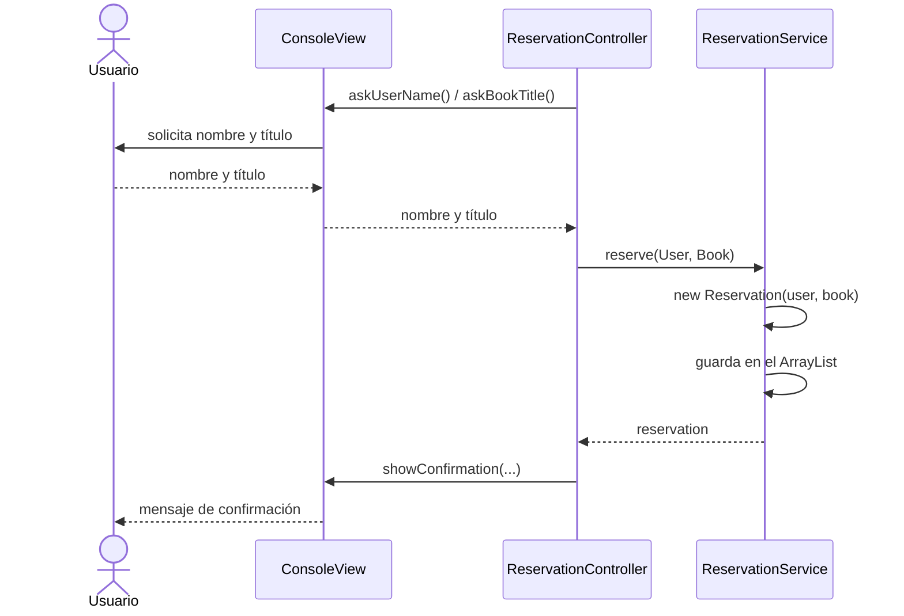

# Ejercicio: Aplicación de reserva de libros de biblioteca (Arquitectura MVC)

Crea una aplicación de consola en Java que permita reservar libros de una biblioteca,
siguiendo la **arquitectura MVC** (Modelo-Vista-Controlador).

## Requisitos funcionales

1. Un menú de consola repetitiu amb aquestes opcions:
   - `1. Nueva reserva`
   - `2. Lista de reservas`
   - `0. Salir`
2. **Nueva reserva**: el usuario introduce su nombre y el título del libro. La aplicación muestra
   un mensaje de confirmación con el nombre del usuario y el título reservado
   (p. ej. `Reserva realizada: Anna ha reservado "El Quijote"`).
3. El usuario puede hacer **más de una reserva** sin reiniciar la aplicación (el menú se repite hasta que elige `0`).
4. **Lista de reservas**: muestra todas las reservas realizadas (usuario y libro).
5. Validaciones mínimas: el nombre y el título no pueden estar vacíos, y una opción de menú no válida
   (o no numérica) debe mostrar un mensaje de error sin detener el programa.

## Requisitos de arquitectura

Organiza el código en tres capas (paquetes). **La vista y el modelo no se conocen entre sí**:
el controlador es el único que los conecta (`view ← controller → model`).

| Paquete | Contenido | Responsabilidad |
|---|---|---|
| `model` | `User`, `Book`, `Reservation`, `ReservationService` | Datos y lógica de negocio. No depende de la vista ni del controlador, ni de `Scanner`/`System.out`. |
| `view` | `ConsoleView` | Interacción con el usuario: solo entrada y salida por consola. |
| `controller` | `ReservationController` | Coordina el flujo entre la vista y el modelo. |

Detalle de las clases:

- **`User`**: datos del usuario (nombre). **`Book`**: datos del libro (título).
- **`Reservation`**: encapsula la reserva (un `User` y un `Book`) y sobrescribe `toString()`.
- **`ReservationService`**: tiene el método `reserve(User, Book)`, que crea la `Reservation` y la guarda en una **lista en memoria** (`ArrayList<Reservation>`, atributo del servicio),
  y el método `getAllReservations()`, que devuelve las reservas guardadas (los datos se pierden al cerrar la aplicación).
- **`ConsoleView`**: muestra el menú, solicita los datos por consola y muestra confirmaciones,
  listas y errores. No contiene lógica de negocio.
- **`ReservationController`**: recibe `ReservationService` y `ConsoleView` mediante el **constructor**,
  ejecuta el bucle del menú, solicita los datos a la vista y llama al servicio.
  No realiza entrada/salida directamente.
- **`MainMVC`**: es el único lugar donde se crean y conectan las piezas
  (modelo → vista → controlador) y se inicia la aplicación.

## Reflexión

> Reflexiona: ahora las reservas se guardan en memoria (`ArrayList`). Si tuvieras que guardarlas en
> un archivo o en una base de datos para que persistan entre ejecuciones, ¿qué clases
> tendrías que modificar? ¿Afectaría a la vista o al controlador? ¿Qué inconveniente tiene que
> `ReservationService` mezcle la lógica de negocio con la forma de guardar los datos?

## Diagrama

Flujo de una nueva reserva:

